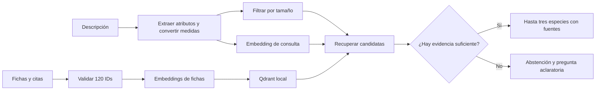
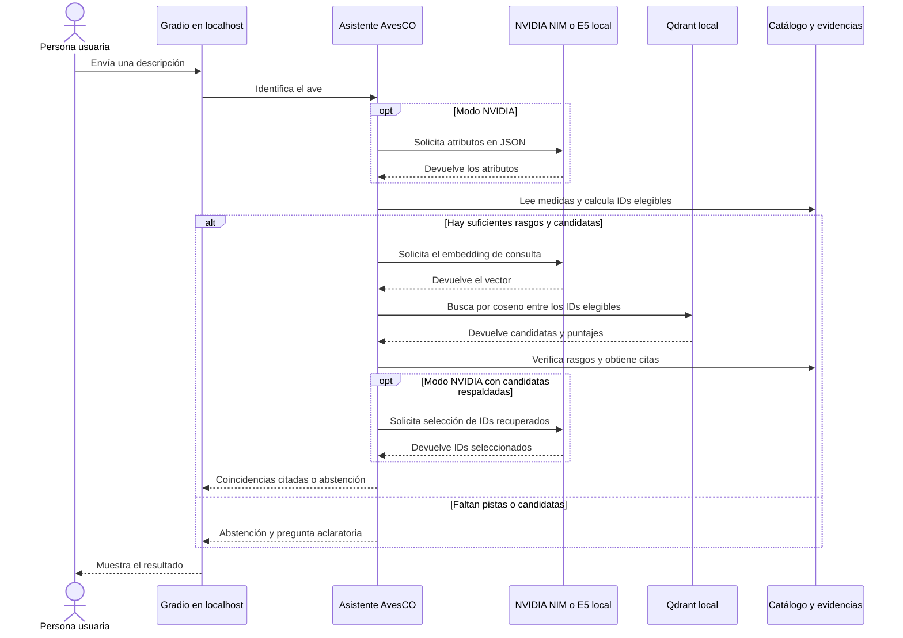

# AvesCO · Identificación de aves del Valle de Aburrá

**SI3003 Inteligencia Artificial · Opción A (RAG) · Sustentación del 17 de noviembre de 2026**  
**Integrantes** · Completar con los nombres del equipo antes de entregar.

## 1. Introducción

AvesCO ayuda a aficionados y estudiantes a reconocer aves a partir de una descripción escrita en español. Busca entre 120 especies documentadas en el Valle de Aburrá y muestra hasta tres coincidencias con referencias que se pueden abrir y revisar.

El resultado es orientativo. El alcance comprende las especies del catálogo y las consultas de texto. El asistente se abstiene si la descripción ofrece pocos rasgos comparables o si las fichas recuperadas carecen de evidencia suficiente.

## 2. Objetivos

**Objetivo general.** Implementar un asistente RAG que sugiera especies del Valle de Aburrá a partir de rasgos observados y cite la evidencia de cada sugerencia.

1. Indexar las 120 fichas y vincular cada una con sus rasgos y fuentes.
2. Recuperar hasta tres candidatas mediante similitud semántica, con un filtro de tamaño y una salida de abstención.
3. Comparar los resultados con una búsqueda por palabras en cinco consultas finales y revisar el respaldo de sus citas.

## 3. Datos

El catálogo cruza registros de ocurrencia del SiB Colombia y GBIF con la guía de la SAO para Envigado, el estudio local de urbanización, la lista ACO y BIRDBASE. Las fichas ya son fragmentos de 84 a 123 palabras y se indexan completas. El preprocesamiento está descrito en el [README del dataset](data/README_datos.md) y la bibliografía con licencias está en [fuentes.csv](data/fuentes.csv).

| Archivo | Formato y uso |
| --- | --- |
| `data/processed/fichas_rag.jsonl` | 120 fragmentos en español. Se indexa `texto` y se conserva `id`. |
| `data/processed/aves.jsonl` | 120 registros con nombre, tamaño en cm, colores, dieta, entorno y otros rasgos. |
| `data/processed/evidencias.jsonl` | Referencias por especie y campo, con URL y localizador. |
| `data/vocabularios.json` | Categorías para validar los atributos de entrada. |
| `data/validacion_muestra.csv` | 15 especies para el cotejo manual del equipo. |

La selección tiene un sesgo de cobertura hacia las especies descritas en Envigado y los sitios con mayor muestreo. Los colores se interpretaron de fotografías y las medidas de la guía se aproximan a la longitud total. El tipo de vuelo está vacío en las 120 fichas. Se preservan las atribuciones CC BY 4.0 y CC BY-NC 4.0 según cada fuente y las condiciones de la guía. El repositorio usa datos estructurados y referencias a la guía, cuyo PDF tiene derechos reservados.

## 4. Metodología

1. **Preparación.** Se comprueban los 120 IDs, los rangos de longitud y la procedencia de las citas. Se indexa un vector por ficha en Qdrant local. La colección se identifica con una huella del archivo y el modelo de embeddings.
2. **Consulta.** Se extraen tamaño, colores, dieta, entorno y vuelo. Se comprueba la medida en el texto original y se convierte a centímetros. Para medidas puntuales se usa ±20 % como tolerancia inicial. Un rango explícito conserva sus extremos. Qdrant recibe solo los IDs con medidas que se solapan con el rango.
3. **Recuperación y respuesta.** El coseno recupera hasta 14 fichas. Se revisan coincidencias y diferencias documentadas y se devuelven hasta tres. La similitud mide cercanía entre vectores. El servidor arma las respuestas a partir de campos reales y enlaza las citas correspondientes.
4. **Modelos.** El modo NVIDIA usa [Nemotron 3.5 Embed 1B](https://build.nvidia.com/nvidia/nemotron-3_5-embed-1b) para los vectores y [Nemotron 3.5 Lightning](https://build.nvidia.com/nvidia/nemotron-3.5-lightning-30b-a3b) para extraer atributos y seleccionar IDs. El modo local usa [multilingual-e5-small](https://huggingface.co/intfloat/multilingual-e5-small) en CPU y aplica reglas para los atributos y la selección. Ambos usan modelos preentrenados, con Qdrant y Gradio en el equipo.
5. **Evaluación.** Se usa como línea base el solapamiento léxico del ejercicio de documentos. Se cuenta si el ID esperado aparece entre los tres primeros en los casos positivos y si hay abstención en el caso externo. Se comprueba que las URLs y localizadores pertenezcan a las fichas citadas. Las consultas de calibración y evaluación quedan fuera del índice.

**Flujo metodológico**



## 5. Diagrama de interacción



## 6. Resultados

El umbral general de similitud coseno es **0,80** con E5 local y **0,26** con NVIDIA. Se ajustó cada umbral con cuatro consultas separadas de los casos finales. En ambos modos, las dos especies esperadas aparecieron entre las candidatas y el asistente se abstuvo en los dos casos negativos. Con NVIDIA, una ficha puede quedar hasta **0,06** por debajo del umbral general si su tamaño está dentro del intervalo escrito, coincide en al menos tres colores y no hay diferencias en los rasgos comparables. Se puede ajustar el umbral general de NVIDIA con `UMBRAL_NVIDIA`.

| Caso y consulta resumida | Esperado | Resultado local | Línea base |
| --- | --- | --- | --- |
| Habitual. Ave roja de 13 cm con alas negras e insectos en un jardín | Titiribí Pechirrojo | 1.ª, guía p. 210 | Fuera de las tres primeras |
| Habitual. Pecho azul violáceo, alas verdosas y 33 cm en humedal | Polla Azul | 1.ª, guía p. 80 | 1.ª |
| Habitual. Gris azulado, alas azules, 16 cm, fruta y parque | Azulejo Común | 1.ª, guía p. 331 | 1.ª |
| Dato de la fuente. Vientre amarillo, ceja blanca y 21–23 cm | Bichofué Común | 2.ª, guía p. 195 | Fuera de las tres primeras |
| Externo. Ave negra y blanca de 110–120 cm que camina sobre hielo | Abstención | Abstención. Cero fichas tras el filtro | Devolvió tres candidatas |

La recuperación local acertó **4/4 en las tres primeras posiciones** y se abstuvo en **1/1** caso externo. La línea base acertó **2/4** y se abstuvo en **0/1**. Las cuatro respuestas con candidatas incluyeron citas recuperadas del catálogo. [Consultas completas](evaluacion/casos.json) · [Respuestas y puntajes registrados](evaluacion/resultados_local.json).

Con la API de NVIDIA, AvesCO acertó **4/4** identificaciones y se abstuvo en **1/1** caso externo. El caso del Bichofué Común sirvió para ajustar la regla de tamaño y colores, por lo que su resultado ilustra el ajuste y requiere validación con observaciones nuevas. [Respuestas y puntajes con NVIDIA](evaluacion/resultados_nvidia.json).

El caso de tamaño excluyó a la Suelda Crestinegra de 17 cm. El Bichofué Picudo de 23 cm quedó por delante del Bichofué Común de 22 cm. Ambos caben en el intervalo y comparten rasgos descritos. Una mejora sería pedir una pista del pico cuando varias fichas coincidan en los rasgos principales. Cinco casos ilustran el comportamiento del prototipo y dejan pendiente una evaluación con más observaciones independientes.

## 7. Reproducibilidad

Desde la raíz del repositorio, con **Python 3.13** en Windows:

```powershell
python -m venv .venv
.venv/Scripts/python.exe -m pip install -r requirements.txt
.venv/Scripts/python.exe app.py --modo local
```

Abre [AvesCO en localhost](http://127.0.0.1:7860). El primer arranque local descarga el modelo E5 cuantizado y su tokenizador, unos 135 MB. Después reutiliza la caché y el índice. El servidor escucha únicamente en `127.0.0.1`.

Para usar NVIDIA, copia `.env.example` a `.env`, completa `NVIDIA_API_KEY` en ese archivo y ejecuta:

```powershell
.venv/Scripts/python.exe app.py --modo nvidia
```

Para reconstruir el índice, evaluar o ejecutar las pruebas, detén la app que tenga abierto el índice del mismo modo y usa:

```powershell
.venv/Scripts/python.exe -m avesco.indice --modo local
.venv/Scripts/python.exe evaluar.py --modo local --calibracion
.venv/Scripts/python.exe evaluar.py --modo local --salida evaluacion/resultados_local.json
.venv/Scripts/python.exe -m pip install -r requirements-dev.txt
.venv/Scripts/python.exe -m pytest -q
```

`app.py` contiene la interfaz, `avesco/` el pipeline, `data/` los datos y sus fuentes, `evaluacion/` los casos y resultados, y `tests/` las pruebas. `.avesco/` almacena el índice y el modelo descargado. `.env` guarda la configuración privada.
