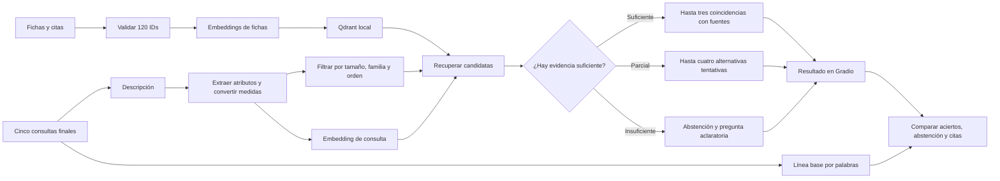
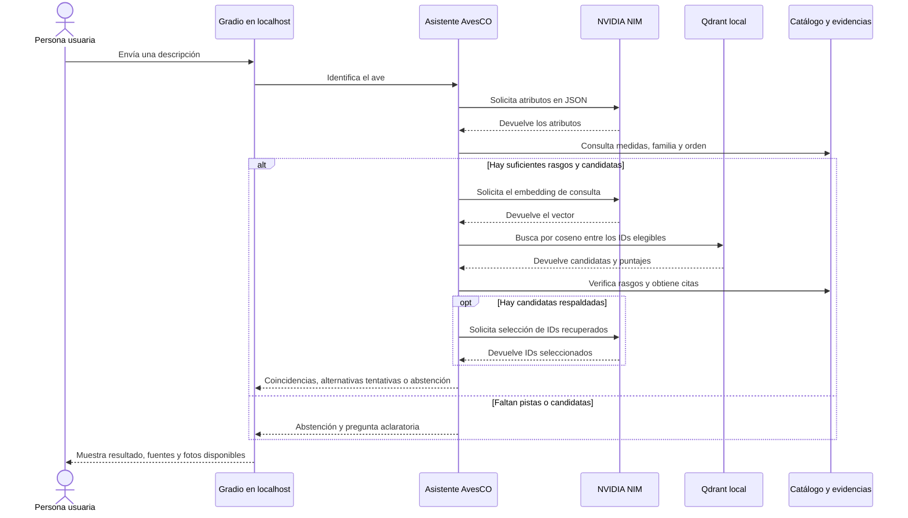

# AvesCO · Identificación de aves del Valle de Aburrá

**Autores** · Julián Jiménez y Alejandro Cifuentes

**Curso** · SI3003

**Fecha** · 12 de noviembre de 2026

## 1. Introducción

AvesCO ayuda a aficionados y estudiantes a reconocer aves a partir de una descripción escrita en español. Las guías regionales suelen consultarse por especie, aunque la persona observadora normalmente empieza con pistas como el color, el tamaño o el lugar. AvesCO cruza esas pistas con 120 fichas del Valle de Aburrá y enlaza las fuentes para que se pueda comprobar cada sugerencia.

El resultado es orientativo. El alcance comprende las especies del catálogo y las consultas de texto. El asistente se abstiene si la descripción ofrece pocos rasgos comparables o si las fichas recuperadas carecen de evidencia suficiente.

## 2. Objetivos

**Objetivo general.** Implementar un asistente RAG que sugiera especies del Valle de Aburrá a partir de rasgos observados y cite la evidencia de cada sugerencia.

1. Indexar las 120 fichas y vincular cada una con sus rasgos y fuentes.
2. Mostrar hasta tres coincidencias o hasta cuatro alternativas de confianza baja, con un filtro de tamaño y una salida de abstención.
3. Comparar los resultados con una búsqueda por palabras en cinco consultas finales y revisar el respaldo de sus citas.

## 3. Datos

El catálogo cruza registros de ocurrencia del SiB Colombia y GBIF con la guía de la SAO para Envigado, el estudio local de urbanización, la lista ACO y BIRDBASE. Los registros se obtienen de las descargas indicadas en `fuentes.csv`. El equipo cruzó los nombres científicos, convirtió las longitudes a centímetros y normalizó colores, dieta y hábitat a categorías comunes. Los campos sin respaldo quedaron vacíos. Se indexa cada ficha completa para mantener juntos los rasgos de una especie. [Proceso de obtención y limpieza](data/README_datos.md) · [Fuentes y licencias](data/fuentes.csv).

| Archivo | Formato y uso |
| --- | --- |
| `data/processed/fichas_rag.jsonl` | 120 fragmentos en español. Se indexa `texto` y se conserva `id`. |
| `data/processed/aves.jsonl` | 120 registros con nombre, tamaño en cm, colores, dieta, entorno y otros rasgos. |
| `data/processed/evidencias.jsonl` | Referencias por especie y campo, con URL y localizador. |
| `data/vocabularios.json` | Categorías para validar los atributos de entrada. |
| `data/validacion_muestra.csv` | 15 especies para el cotejo manual del equipo. |

La selección tiene un sesgo de cobertura hacia las especies descritas en Envigado y los sitios con mayor muestreo. Los colores se interpretaron de fotografías y las medidas de la guía se aproximan a la longitud total. El tipo de vuelo está vacío en las 120 fichas. Se preservan las atribuciones CC BY 4.0 y CC BY-NC 4.0 según cada fuente y las condiciones de la guía. Se puede ejecutar con los datos estructurados incluidos. La guía tiene derechos reservados y las fotos que la interfaz puede mostrar se cargan desde archivos locales.

## 4. Metodología

1. **Preparación.** Se validan los IDs, las medidas y las citas. Nemotron 3.5 Embed 1B genera un vector por ficha en español para recuperar especies por similitud semántica. Qdrant guarda los vectores localmente y reutiliza el índice cuando coinciden el catálogo y el modelo.
2. **Interpretación y filtros.** Nemotron 3.5 Lightning extrae atributos en JSON. Se comprueban colores, dieta y medidas contra la descripción. Se conserva un intervalo explícito y se usa ±20 % para una medida puntual, por la incertidumbre al estimar el tamaño. Se filtra por tamaño, familia u orden cuando hay pistas aplicables.
3. **Recuperación y respuesta.** Se ordenan por coseno las fichas elegibles. Se revisan las primeras 14 para coincidencias, con una excepción para candidatas urbanas compatibles con comida humana. El modelo puede seleccionar hasta tres entre las cinco mejor respaldadas. El umbral general es 0,26. Las alternativas tentativas requieren al menos 0,24 y se limitan a cuatro. Una ficha puede entrar hasta 0,06 por debajo del umbral general cuando su longitud cabe en el intervalo escrito, coincide en tres o más colores y carece de diferencias comparables. La similitud expresa cercanía entre vectores.
4. **Evaluación.** Se calibró el umbral con cuatro consultas separadas de los cinco casos finales. La línea base cuenta palabras compartidas entre la consulta y las fichas. Se mide acierto entre los primeros tres resultados para las cuatro consultas positivas, abstención para la consulta externa y correspondencia de las citas con la evidencia del catálogo. Las consultas quedan fuera del índice.
5. **Ejecución.** Se usan los modelos de NVIDIA NIM ya entrenados. Gradio muestra en el navegador los resultados citados, mantiene las aclaraciones de una misma observación y puede mostrar fotos locales. La API de NVIDIA requiere una clave e internet.

**Flujo metodológico**



## 5. Diagrama de interacción (UML)

**Secuencia de una consulta con el índice disponible**



## 6. Resultados

| Caso | Resultado esperado | Línea base | AvesCO con NVIDIA |
| --- | --- | --- | --- |
| Ave roja con alas negras de 13 cm | *Pyrocephalus rubinus* | No | Sí |
| Ave de pecho azul violáceo de 33 cm en humedal | *Porphyrio martinica* | Sí | Sí |
| Ave gris azulada de 16 cm que comía frutas | *Thraupis episcopus* | Sí | Sí |
| Ave de vientre amarillo con ceja blanca de 21–23 cm | *Pitangus sulphuratus* | No | Sí |
| Ave negra y blanca de 110–120 cm sobre hielo | Abstención | No | Sí |
| **Identificaciones entre las tres primeras** | **4 casos** | **2/4** | **4/4** |
| **Abstención** | **1 caso** | **0/1** | **1/1** |

Las cuatro respuestas con especies incluyeron citas con URL y localizador que corresponden a las fichas. [Consultas completas](evaluacion/casos.json) · [Resultados registrados](evaluacion/resultados_nvidia.json).

El filtro de tamaño dejó fuera a la Suelda Crestinegra de 17 cm. El Bichofué Común de 22 cm quedó primero y el Bichofué Picudo de 23 cm segundo, porque ambos encajan en las medidas y el plumaje descrito. Ese caso también sirvió para ajustar la regla de tamaño y color. Una pista sobre el pico ayudaría a distinguirlos. Los cinco casos ilustran el comportamiento del prototipo y dejan pendiente una evaluación con observaciones independientes.

## 7. Reproducibilidad

Desde la raíz del repositorio, con **Python 3.13** en Windows:

```powershell
python -m venv .venv
.venv/Scripts/python.exe -m pip install -r requirements.txt
```

Copia `.env.example` a `.env` y completa `NVIDIA_API_KEY`. Con conexión a internet, ejecuta:

```powershell
.venv/Scripts/python.exe app.py --puerto 7861
```

Abre [AvesCO](http://127.0.0.1:7861). El primer arranque crea el índice con embeddings de NVIDIA. Después reutiliza el índice y llama a la API para procesar consultas nuevas.

Para reconstruir el índice o evaluar, detén primero la app si está usando el índice:

```powershell
.venv/Scripts/python.exe -m avesco.indice
.venv/Scripts/python.exe evaluar.py --calibracion
.venv/Scripts/python.exe evaluar.py
.venv/Scripts/python.exe -m pip install -r requirements-dev.txt
.venv/Scripts/python.exe -m pytest -q
```

| Ruta | Contenido |
| --- | --- |
| `app.py` y `avesco/` | Interfaz Gradio y código del asistente. |
| `data/` y `scripts/` | Catálogo, evidencias y preparación del dataset. |
| `evaluacion/`, `evaluar.py` y `evaluar_robustez.py` | Casos, resultados y evaluadores. |
| `tests/` | Pruebas automatizadas. |
| `.env` y `.avesco/` | Configuración privada e índice local, excluidos de Git. |
