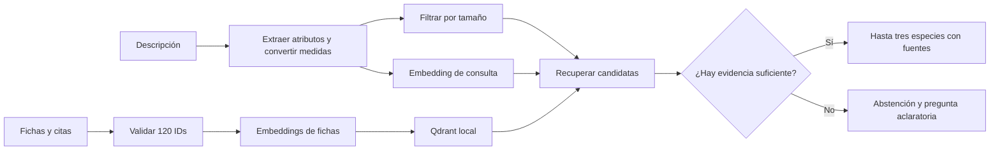
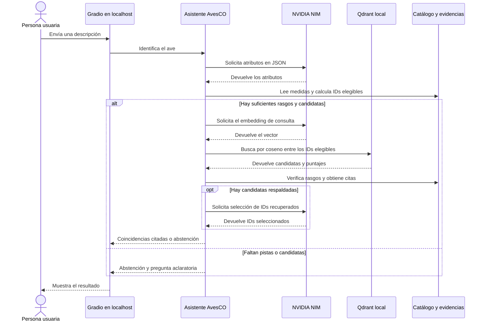

# AvesCO · Identificación de aves del Valle de Aburrá

**Integrantes** · Julián Jiménez y Alejandro Cifuentes

## 1. Introducción

AvesCO ayuda a aficionados y estudiantes a reconocer aves a partir de una descripción escrita en español. Busca entre 120 especies documentadas en el Valle de Aburrá y muestra hasta tres coincidencias con referencias que se pueden abrir y revisar.

El resultado es orientativo. El alcance comprende las especies del catálogo y las consultas de texto. El asistente se abstiene si la descripción ofrece pocos rasgos comparables o si las fichas recuperadas carecen de evidencia suficiente.

## 2. Objetivos

**Objetivo general.** Implementar un asistente RAG que sugiera especies del Valle de Aburrá a partir de rasgos observados y cite la evidencia de cada sugerencia.

1. Indexar las 120 fichas y vincular cada una con sus rasgos y fuentes.
2. Recuperar hasta tres candidatas mediante similitud semántica, con un filtro de tamaño y una salida de abstención.
3. Comparar los resultados con una búsqueda por palabras en cinco consultas finales y revisar el respaldo de sus citas.

## 3. Datos

El catálogo cruza registros de ocurrencia del SiB Colombia y GBIF con la guía de la SAO para Envigado, el estudio local de urbanización, la lista ACO y BIRDBASE. Las fichas ya son fragmentos de 84 a 123 palabras y se indexan completas. El preprocesamiento está descrito en el [README del dataset](data/README_datos.md) y la bibliografía con licencias está en [fuentes.csv](data/fuentes.csv).

| Archivo | Formato y uso |
| --- | --- |
| `data/processed/fichas_rag.jsonl` | 120 fragmentos en español. Se indexa `texto` y se conserva `id`. |
| `data/processed/aves.jsonl` | 120 registros con nombre, tamaño en cm, colores, dieta, entorno y otros rasgos. |
| `data/processed/evidencias.jsonl` | Referencias por especie y campo, con URL y localizador. |
| `data/vocabularios.json` | Categorías para validar los atributos de entrada. |
| `data/validacion_muestra.csv` | 15 especies para el cotejo manual del equipo. |

La selección tiene un sesgo de cobertura hacia las especies descritas en Envigado y los sitios con mayor muestreo. Los colores se interpretaron de fotografías y las medidas de la guía se aproximan a la longitud total. El tipo de vuelo está vacío en las 120 fichas. Se preservan las atribuciones CC BY 4.0 y CC BY-NC 4.0 según cada fuente y las condiciones de la guía. El repositorio usa datos estructurados y referencias a la guía, cuyo PDF tiene derechos reservados.

## 4. Metodología

1. **Preparación.** Se comprueban los 120 IDs, los rangos de longitud y la procedencia de las citas. Se indexa un vector por ficha en Qdrant local. La colección se identifica con una huella del archivo y el modelo de embeddings.
2. **Consulta.** Se extraen tamaño, colores, dieta, entorno y vuelo. Se comprueba la medida en el texto original y se convierte a centímetros. Para medidas puntuales se usa ±20 % como tolerancia inicial. Un rango explícito conserva sus extremos. Qdrant recibe solo los IDs con medidas que se solapan con el rango.
3. **Recuperación y respuesta.** El coseno recupera hasta 14 fichas. Se revisan coincidencias y diferencias documentadas y se devuelven hasta tres. La similitud mide cercanía entre vectores. El servidor arma las respuestas a partir de campos reales y enlaza las citas correspondientes. Las opciones de confianza baja también exigen una similitud de al menos 0,02 por debajo del umbral.
4. **Controles.** Las medidas distinguen longitud corporal de envergadura y se convierten a centímetros. El asistente comprueba los colores y la dieta contra las palabras de la descripción, y aplica los filtros de familia y orden cuando el usuario indica el grupo. La conversación conserva las aclaraciones de una observación. Si falla la API, muestra el error y permite reintentar. Las migas de pan favorecen especies urbanas granívoras u omnívoras. Las opciones tentativas requieren una similitud de al menos el umbral general menos 0,02.
5. **Modelos.** AvesCO usa [Nemotron 3.5 Embed 1B](https://build.nvidia.com/nvidia/nemotron-3_5-embed-1b) para los vectores y [Nemotron 3.5 Lightning](https://build.nvidia.com/nvidia/nemotron-3.5-lightning-30b-a3b) para extraer atributos y seleccionar IDs. La clave NVIDIA_API_KEY es obligatoria.
6. **Evaluación.** Se usa como línea base el solapamiento léxico del ejercicio de documentos. Se cuenta si el ID esperado aparece entre los tres primeros en los casos positivos y si hay abstención en el caso externo. Se comprueba que las URLs y localizadores pertenezcan a las fichas citadas. Las consultas de calibración y evaluación quedan fuera del índice.

**Flujo metodológico**



## 5. Diagrama de interacción



## 6. Resultados

El umbral general de similitud coseno es **0,26**. Se ajustó el umbral con cuatro consultas separadas de los casos finales. Las dos especies esperadas aparecieron entre las candidatas y el asistente se abstuvo en los dos casos negativos. Con NVIDIA, una ficha puede quedar hasta **0,06** por debajo del umbral general si su tamaño está dentro del intervalo escrito, coincide en al menos tres colores y no hay diferencias en los rasgos comparables. Se puede ajustar el umbral general de NVIDIA con `UMBRAL_NVIDIA`.

[Consultas completas](evaluacion/casos.json).

Con la API de NVIDIA, AvesCO acertó **4/4** identificaciones y se abstuvo en **1/1** caso externo. El caso del Bichofué Común sirvió para ajustar la regla de tamaño y colores, por lo que su resultado ilustra el ajuste y requiere validación con observaciones nuevas. [Respuestas y puntajes con NVIDIA](evaluacion/resultados_nvidia.json).

El caso de tamaño excluyó a la Suelda Crestinegra de 17 cm. El Bichofué Común de 22 cm quedó primero y el Bichofué Picudo de 23 cm segundo. Ambos caben en el intervalo y comparten rasgos descritos. Una mejora sería pedir una pista del pico cuando varias fichas coincidan en los rasgos principales. Cinco casos ilustran el comportamiento del prototipo y dejan pendiente una evaluación con más observaciones independientes.

## 7. Reproducibilidad

Desde la raíz del repositorio, con **Python 3.13** en Windows:

```powershell
python -m venv .venv
.venv/Scripts/python.exe -m pip install -r requirements.txt
```

Crea `.env` a partir de `.env.example` y completa `NVIDIA_API_KEY`. Inicia la interfaz:

```powershell
.venv/Scripts/python.exe app.py --puerto 7861
```

Abre [AvesCO](http://127.0.0.1:7861). El primer arranque crea el índice con embeddings de NVIDIA. Después reutiliza el índice y llama a la API para procesar consultas nuevas.

Para reconstruir el índice o evaluar, detén primero la app si está usando el índice:

```powershell
.venv/Scripts/python.exe -m avesco.indice
.venv/Scripts/python.exe evaluar.py --calibracion
.venv/Scripts/python.exe evaluar.py --salida evaluacion/resultados_nvidia.json
.venv/Scripts/python.exe -m pip install -r requirements-dev.txt
.venv/Scripts/python.exe -m pytest -q
```

`app.py` contiene la interfaz, `avesco/` el pipeline, `data/` los datos y sus fuentes, `evaluacion/` los casos y resultados, y `tests/` las pruebas. `.avesco/` almacena el índice. `.env` guarda la configuración privada.
