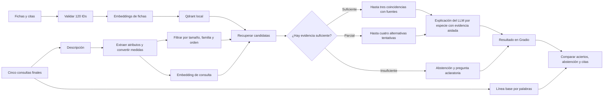
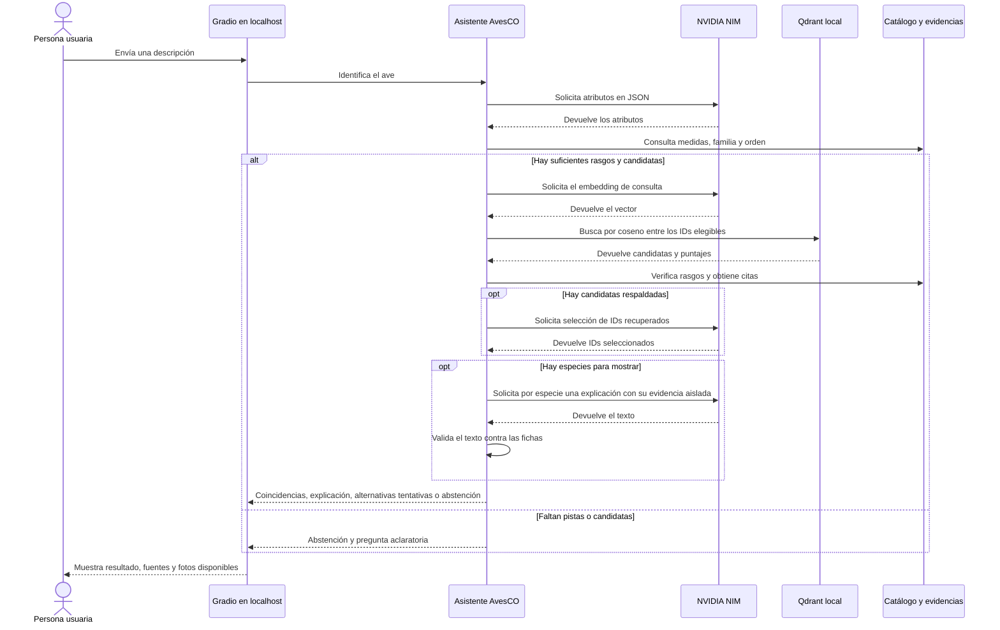

# AvesCO · Identificación de aves del Valle de Aburrá

**Autores** · Julián Jiménez y Alejandro Cifuentes · **Curso** · SI3003 Inteligencia Artificial ·

## 1. Introducción

AvesCO ayuda a aficionados y estudiantes a reconocer aves a partir de una descripción escrita en español. Las guías regionales suelen consultarse por especie, aunque la persona observadora normalmente empieza con pistas como el color, el tamaño o el lugar. AvesCO cruza esas pistas con 120 fichas del Valle de Aburrá y enlaza las fuentes para que se pueda comprobar cada sugerencia.

El resultado es orientativo. El alcance comprende las especies del catálogo y las consultas de texto. El asistente se abstiene si la descripción ofrece pocos rasgos comparables o si las fichas recuperadas carecen de evidencia suficiente.

## 2. Objetivo

**Objetivo general.** Implementar un asistente RAG que sugiera especies del Valle de Aburrá a partir de rasgos observados y cite la evidencia de cada sugerencia.

1. Indexar las 120 fichas y vincular cada una con sus rasgos y fuentes.
2. Mostrar hasta tres coincidencias o hasta cuatro alternativas de confianza baja, con un filtro de tamaño y una salida de abstención.
3. Comparar los resultados con una búsqueda por palabras en cinco consultas finales y revisar el respaldo de sus citas.

## 3. Descripción de los datos

El catálogo cruza registros de ocurrencia del SiB Colombia y GBIF con la guía de la SAO para Envigado, el estudio local de urbanización, la lista ACO y BIRDBASE. Los registros se obtienen de las descargas indicadas en `fuentes.csv`. El equipo cruzó los nombres científicos, convirtió las longitudes a centímetros y normalizó colores, dieta y hábitat a categorías comunes. Los campos sin respaldo quedaron vacíos. Se indexa cada ficha completa para mantener juntos los rasgos de una especie. [Fuentes y descargas](data/fuentes.csv).

El catálogo reúne 120 especies en JSONL. Los campos principales son:

| Variables | Contenido |
| --- | --- |
| ID, nombres, familia y orden | Identificación y clasificación de cada especie. |
| Longitud mínima y máxima | Tamaño en centímetros. |
| Colores, plumaje, dieta y entorno | Rasgos comparados con la observación. |
| Texto de ficha | Descripción en español para la búsqueda vectorial. |
| Fuente, URL y localizador | Evidencia por especie y rasgo. |

La selección tiene un sesgo de cobertura hacia las especies descritas en Envigado y los sitios con mayor muestreo. Los colores se interpretaron de fotografías y las medidas de la guía se aproximan a la longitud total. El tipo de vuelo está vacío en las 120 fichas. Las fuentes CC BY 4.0 requieren atribución. Las CC BY-NC 4.0 limitan el uso a fines no comerciales y también requieren atribución. Se puede ejecutar con los datos estructurados incluidos. La guía tiene derechos reservados y las fotos que la interfaz puede mostrar se cargan desde archivos locales.

## 4. Metodología

1. **Preparación.** Se validan los IDs, las medidas y las citas. Nemotron 3.5 Embed 1B genera un vector por ficha en español para recuperar especies por similitud semántica. Qdrant guarda los vectores localmente y reutiliza el índice cuando coinciden el catálogo y el modelo.
2. **Interpretación y filtros.** Nemotron 3.5 Lightning extrae atributos en JSON. Se comprueban colores, dieta y medidas contra la descripción. Se conserva un intervalo explícito y se usa ±20 % para una medida puntual, por la incertidumbre al estimar el tamaño. Se filtra por tamaño, familia u orden cuando hay pistas aplicables.
3. **Recuperación y respuesta.** Se ordenan por coseno las fichas elegibles. Se revisan las primeras 14 para coincidencias, con una excepción para candidatas urbanas compatibles con comida humana. El modelo puede seleccionar hasta tres entre las cinco mejor respaldadas. El umbral general es 0,26. Las alternativas tentativas requieren al menos 0,24 y se limitan a cuatro. Una ficha puede entrar hasta 0,06 por debajo del umbral general cuando su longitud cabe en el intervalo escrito, coincide en tres o más colores y carece de diferencias comparables. La similitud expresa cercanía entre vectores. Con las fichas ya elegidas, Nemotron 3.5 Lightning redacta hasta 35 palabras por especie en llamadas independientes. Cada llamada recibe solo las coincidencias de esa candidata, sin la consulta libre, nombres, medidas ni otras fichas. El programa coloca nombres, tamaños, citas y las pistas exactas pendientes de contrastar. El LLM no decide ni reformula esos pendientes. Los controles rechazan, entre otros, claves internas, cifras, nombres y rasgos ajenos a esa evidencia; no constituyen una verificación semántica completa. Si un borrador falla, se conservan las fichas, sus citas y las explicaciones válidas de las demás candidatas. Las descripciones con solo tamaño, comida y entorno, sin colores, nombre ni familia explícitos, producen como máximo opciones tentativas y solicitan más pistas.
4. **Evaluación.** Se calibró el umbral con cuatro consultas separadas de los cinco casos finales. La línea base cuenta palabras compartidas entre la consulta y las fichas. Se mide acierto entre los primeros tres resultados para las cuatro consultas positivas, abstención para la consulta externa y correspondencia de las citas con la evidencia del catálogo. Las consultas quedan fuera del índice. El evaluador también registra cuántas explicaciones pasaron la validación.
5. **Ejecución.** Se usan los modelos de NVIDIA NIM ya entrenados. Gradio muestra en el navegador los resultados citados, mantiene las aclaraciones de una misma observación y puede mostrar fotos locales. La API de NVIDIA requiere una clave e internet.

**Flujo metodológico**



## 5. Diagrama de interacción (UML)

**Secuencia de una consulta con el índice disponible**



## 6. Resultados

Las dos tablas provienen de [evaluacion/resultados_nvidia.json](evaluacion/resultados_nvidia.json). Las consultas se reproducen tal como aparecen en el archivo y las especies de la respuesta se muestran en el orden registrado.

| Consulta | Resultado esperado | Respuesta obtenida | Valoración manual |
| --- | --- | --- | --- |
| Vi un ave de unos 13 cm, roja con alas negras. Atrapaba insectos en un jardín. | *Pyrocephalus rubinus* | Titiribí Pechirrojo | pendiente |
| En un humedal vi un ave de unos 33 cm con pecho azul violáceo y alas verdosas. | *Porphyrio martinica* | Polla Azul | pendiente |
| En un parque vi un ave gris azulada con alas de azul más intenso. Era de unos 16 cm y comía frutas. | *Thraupis episcopus* | Azulejo Común → Azulejo Palmero → Periquito Bronceado | pendiente |
| Era de vientre amarillo y cabeza negra con ceja blanca. Medía entre 21 y 23 cm. ¿Qué coincidencia encaja con esa medida? | *Pitangus sulphuratus* | Bichofué Común → Bichofué Picudo | pendiente |
| Vi un ave negra y blanca de entre 110 y 120 cm que caminaba erguida sobre el hielo. ¿Qué ave era? | Abstención | No puedo identificar el ave con la información disponible. Ninguna ficha coincide con esa medida. ¿Puedes revisar el tamaño aproximado? | pendiente |

| Métrica | Línea base por palabras | RAG con NVIDIA |
| --- | --- | --- |
| Aciertos sobre el total | 2/5 | 5/5 |
| Respuestas con citas válidas entre las evaluadas | Sin registro en el JSON | 4/4 |
| Abstención en casos externos | 0/1 | 1/1 |
| Explicaciones aceptadas | No aplica | pendiente de regenerar |

Un acierto corresponde a encontrar la especie esperada entre las tres primeras o a abstenerse cuando el caso espera abstención. Las citas se verifican en las respuestas para las que el JSON registra `citas_del_catalogo`.

El caso del Bichofué Común también sirvió para ajustar la regla de tamaño y color. El sistema también propuso el Bichofué Picudo como segunda opción, aunque la especie esperada era el Bichofué Común. Una pista sobre el pico ayudaría a distinguirlos. Queda pendiente evaluar el sistema con observaciones independientes.

## 7. Reproducibilidad

Usa Python 3.13 y conexión a internet. Desde la raíz del repositorio, instala las dependencias y crea `.env`:

**Windows (PowerShell)**
```powershell
python -m venv .venv
.venv/Scripts/python.exe -m pip install -r requirements-dev.txt
Copy-Item .env.example .env
```

**Linux/macOS (Bash o Zsh)**
```bash
python3 -m venv .venv
source .venv/bin/activate
python -m pip install -r requirements-dev.txt
cp .env.example .env
```

Completa `NVIDIA_API_KEY` en `.env` y abre [AvesCO](http://127.0.0.1:7861) tras iniciar la interfaz. El primer arranque crea el índice. Detén la interfaz antes de ejecutar la evaluación si comparten el índice.

| Acción | Windows (PowerShell) | Linux/macOS con el entorno activo |
| --- | --- | --- |
| Interfaz | `.venv/Scripts/python.exe app.py --puerto 7861` | `python app.py --puerto 7861` |
| Pruebas | `.venv/Scripts/python.exe -m pytest -q` | `python -m pytest -q` |
| Evaluación final | `.venv/Scripts/python.exe evaluar.py` | `python evaluar.py` |

**Estructura del repositorio**

```text
app.py                         Interfaz
avesco/                        Asistente, catálogo e índice
data/                          Fichas, fuentes y evidencias
scripts/                       Preparación del catálogo
evaluar.py / evaluar_robustez.py  Evaluación
evaluacion/                    Casos y resultados
tests/                         Pruebas automatizadas
```
